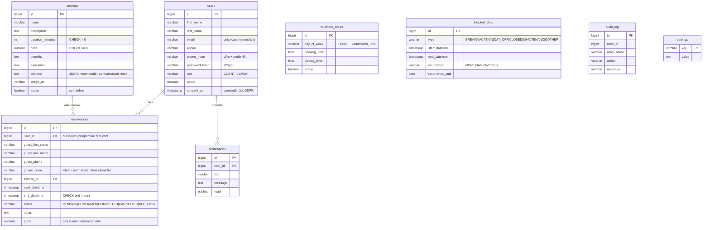

# Arhitectură

## 1. Vedere de ansamblu

```
Browser ──► Frontend (React + Vite, servit de nginx)
               │  /api/*  (reverse proxy; în dev: proxy Vite)
               ▼
            Backend (Quarkus, REST + JWT)
               │  Hibernate ORM / Panache (JDBC)
               ▼
            PostgreSQL 16  (schema gestionată de Flyway)
```

| Strat | Tehnologii | Responsabilitate |
|---|---|---|
| Frontend | React 18, TypeScript, Vite, Tailwind, React Router, TanStack Query, FullCalendar | UI, validări de confort, stări loading/error/empty |
| API | Quarkus REST (RESTEasy Reactive), Bean Validation, OpenAPI | contract HTTP, autentificare/autorizare, erori uniforme |
| Servicii | CDI beans (`service/`) | reguli de business: disponibilitate, rezervări, notificări, audit, statistici |
| Persistență | Hibernate ORM + Panache, Flyway | acces la date, migrații |
| Bază de date | PostgreSQL | constrângeri (inclusiv anti-suprapunere), integritate |

**Backend-ul este autoritatea finală** pentru orice regulă (disponibilitate, roluri, politică de anulare). Frontend-ul doar ghidează utilizatorul.

### Structura backend (`backend/src/main/java/ro/salon`)

| Pachet | Conținut |
|---|---|
| `resource/` | endpoint-uri REST (`AuthResource`, `ReservationResource`, …) |
| `service/` | logica de business (`ReservationService`, `AvailabilityService`, `StatsService`, …) |
| `repository/` | interogări complexe (`ReservationRepository`); entitățile simple folosesc Panache active-record |
| `entity/` | entități JPA |
| `dto/` | obiecte de transfer (records) cu validări |
| `security/` | JWT (`TokenService`), `@Secured`, `AuthFilter`, rate limiter, headere de securitate |
| `exception/` | `ApiException` + mapare uniformă a erorilor |
| `config/` | `DataInitializer` (date inițiale + demo) |

### Structura frontend (`frontend/src`)

`components/` (UI reutilizabil, `booking/`, `admin/`), `pages/` (public, `client/`, `admin/`), `layouts/`, `services/` (client HTTP + endpoint-uri), `hooks/` (auth, toast, setări), `types/`, `utils/`.

## 2. Schema bazei de date

Sursa adevărului: `backend/src/main/resources/db/migration/V1__init.sql`.



Toate datele/orele sunt stocate ca **ora locală a salonului** (`TIMESTAMP`, fără fus orar). Fusul orar al salonului (setare, implicit `Europe/Bucharest`) este folosit pentru a decide ce înseamnă „acum”.

### Constrângeri (nivel bază de date)

* `users`: email unic (`lower(email)`), `role` limitat la `CLIENT|ADMIN`.
* `services`: durată 1–480 min, preț ≥ 0.
* `reservations`: chei străine, `end_datetime > start_datetime`, status valid și:

  ```sql
  EXCLUDE USING gist (service_id WITH =, tsrange(start_datetime, end_datetime) WITH &&)
  WHERE (status IN ('PENDING','CONFIRMED','COMPLETED'))
  ```

  Două rezervări active ale aceluiași serviciu (= aceeași resursă) **nu se pot suprapune**, indiferent ce face aplicația. Rezervările anulate / no-show eliberează intervalul.
* `business_hours`: o singură linie pe zi, `closing_time > opening_time`.
* `blocked_slots`: `end > start`, tip și recurență validate.

## 3. Roluri și permisiuni

| Acțiune | Public | CLIENT | ADMIN |
|---|:-:|:-:|:-:|
| Vezi servicii, program, setări, disponibilitate | ✔ | ✔ | ✔ |
| Înregistrare / login / resetare parolă | ✔ | ✔ | ✔ |
| Creează rezervare **fără cont** (nume, prenume, telefon) | ✔ | ✔ | ✔ |
| Creează rezervare (pentru sine) | | ✔ | ✔ |
| Vezi / modifică / anulează **propriile** rezervări (cu politica de anulare) | | ✔ | ✔ |
| Vezi rezervările altor clienți | | ✘ (404) | ✔ |
| Confirmă / finalizează / marchează absent / șterge rezervări | | ✘ | ✔ |
| Creează rezervări pentru alt client, mută rezervări | | ✘ | ✔ |
| Gestionează servicii, program, intervale blocate, setări | | ✘ | ✔ |
| Listează / caută clienți, statistici, jurnal de audit | | ✘ | ✔ |
| Profil propriu: editare, schimbare parolă, export și ștergere date (GDPR) | | ✔ | ✔ |

Autorizarea se face în backend (`@Secured` + `AuthFilter`); rolul se citește din baza de date la fiecare cerere, deci dezactivarea unui cont are efect imediat. Un client care cere resursa altuia primește **404** (nu se divulgă existența).

## 4. API REST

Documentație interactivă (Swagger UI): `/api/docs` — schema OpenAPI: `/api/openapi`.
Autentificare: `Authorization: Bearer <jwt>` (token obținut de la `POST /api/auth/login`).

| Metodă | Cale | Acces | Descriere |
|---|---|---|---|
| POST | `/api/auth/register` | public | creează cont CLIENT (cere consimțământ) |
| POST | `/api/auth/login` | public | JWT; rate limit pe email și IP |
| POST | `/api/auth/logout` | public | tokenuri stateless; clientul îl șterge |
| POST | `/api/auth/forgot-password` | public | răspunde mereu 202 |
| POST | `/api/auth/reset-password` | public | setează parola cu token de unică folosință (1 h) |
| GET | `/api/auth/me` | auth | utilizatorul curent |
| GET | `/api/services`, `/api/services/{id}` | public | servicii active (`?all=true` pentru admin) |
| POST/PUT/DELETE | `/api/services[/{id}]` | admin | CRUD; `DELETE` = soft-delete dacă are rezervări |
| POST | `/api/services/{id}/activate` \| `/deactivate` | admin | reactivare / dezactivare |
| GET | `/api/availability?serviceId=&date=` | public | sloturi libere/ocupate (cu motiv) |
| GET | `/api/availability/days?serviceId=&month=yyyy-MM` | public | zilele cu locuri libere |
| POST | `/api/guest/reservations` | public | rezervare fără cont; limitată pe IP (10/h) și pe telefon (5/zi) |
| GET | `/api/users/guests` | admin | clienți fără cont, grupați după telefon, cu vizite |
| GET | `/api/reservations` | auth | listă (client: ale lui; admin: toate + filtre/sortare/paginare) |
| GET | `/api/reservations/calendar?from=&to=` | auth | pentru calendar |
| GET/POST/PUT | `/api/reservations[/{id}]` | auth | detalii / creare / modificare |
| POST | `/api/reservations/{id}/cancel` | auth | anulare (client: politica de anulare) |
| POST | `/api/reservations/{id}/confirm` \| `/complete` \| `/no-show` | admin | schimbări de status |
| DELETE | `/api/reservations/{id}` | admin | ștergere definitivă |
| GET | `/api/users`, POST `/api/users` | admin | căutare clienți / creare |
| GET/PUT | `/api/users/{id}` | self/admin | profil |
| POST | `/api/users/{id}/password` | self | schimbare parolă |
| POST | `/api/users/{id}/deactivate` | self/admin | dezactivare cont |
| GET | `/api/users/{id}/export` | self/admin | GDPR: exportul datelor |
| DELETE | `/api/users/{id}` | self/admin | GDPR: ștergerea datelor personale (anonimizare) |
| GET/PUT | `/api/schedule` | public(GET) / admin(PUT) | program săptămânal |
| GET/POST/DELETE | `/api/schedule/blocked[/{id}]` | admin | pauze, concedii, zile libere, mentenanță |
| GET/PUT | `/api/settings` | public(GET) / admin(PUT) | informații salon și reguli |
| GET, POST | `/api/notifications`, `/{id}/read`, `/read-all` | auth | notificări in-app |
| GET | `/api/stats/dashboard`, `/api/stats/report?period=`, `/api/stats/export?period=` | admin | statistici, export CSV |
| GET | `/api/audit` | admin | jurnal de audit |

### Format de eroare

```json
{ "status": 409, "message": "The selected time slot is already booked.", "timestamp": "2026-10-06T15:30:00", "code": "SLOT_TAKEN" }
```

Erorile de validare adaugă `"errors": { "email": "..." }`. `code` este stabil și este tradus în mesaje prietenoase de frontend (`utils/errors.ts`).

## 5. Fluxul de rezervare

1. Clientul alege serviciul → frontend cere `/api/availability/days` și `/api/availability` (date reale din DB).
2. Selectează ziua și ora; sloturile ocupate/blocate sunt dezactivate („Rezervat”, „Indisponibil”).
3. `POST /api/reservations` — în **aceeași tranzacție** backend-ul:
   1. blochează rândul serviciului (`SELECT … FOR UPDATE`) → cererile concurente pentru același serviciu se execută pe rând;
   2. recalculează disponibilitatea și verifică slotul (`AvailabilityService.assertBookable`);
   3. inserează rezervarea; la `flush`, constrângerea `EXCLUDE` din PostgreSQL este plasa de siguranță (SQLState `23P01` → `409 SLOT_TAKEN`);
   4. creează notificările și, pentru acțiuni de admin, intrarea în jurnalul de audit.
4. Rezervarea apare în „Rezervările mele” și în calendarul adminului; slotul devine indisponibil pentru ceilalți.

## 6. Reguli de disponibilitate

Un slot `[start, start + durata serviciului)` este **liber** dacă, pentru ziua respectivă:

* ziua este activă în `business_hours` și în orizontul de rezervare (setare, implicit 90 zile);
* `start ≥ deschidere` și `end ≤ închidere`; `start` pică pe grila `deschidere + k·pas` (pas = setare, implicit 30 min);
* `start` este în viitor (pentru clienți);
* nu se suprapune cu niciun `blocked_slot` (inclusiv recurente zilnic/săptămânal, ex. pauza 12:00–13:00);
* nu se suprapune cu o rezervare activă (PENDING/CONFIRMED/COMPLETED) a **aceluiași serviciu**.

Motivul unui slot indisponibil este expus ca `BOOKED`, `BLOCKED` sau `PAST` — niciodată datele clientului care a rezervat.

## 6b. Clienți fără cont și identificarea după telefon

O programare poate avea `user_id` nul; atunci conține numele, prenumele și telefonul oaspetelui (`CHECK chk_reservation_client`). Numele nu sunt unice, deci **identitatea unui client este telefonul normalizat** (`Phones.normalize`: doar cifre, fără `00`, număr național `07…` → `407…`). Același câmp `phone_norm` există pe `users` și pe `reservations`.

* **Vizite** = numărul de rezervări `COMPLETED` cu același `phone_norm` (conturi și oaspeți la un loc). Dacă un oaspete își face ulterior cont cu același număr, istoricul i se atașează automat.
* Oaspeții nu primesc notificări in-app (nu au cont); la confirmare văd rezumatul pe ecran, iar anularea/modificarea se face telefonic sau de către admin. Adminul vede programarea marcată 

Clientul poate anula/modifica doar rezervări `PENDING`/`CONFIRMED`, cu cel puțin `cancellationHours` (setare, implicit 2) înainte de început; altfel `403 CANCELLATION_WINDOW`. Adminul nu este limitat. O rezervare mutată de client revine la `PENDING` dacă salonul nu confirmă automat.

## 8. Extensibilitate

| Funcționalitate viitoare | Unde se conectează |
|---|---|
| Email / SMS / WhatsApp | implementează `NotificationChannel` (bean CDI) — este apelat automat pentru fiecare notificare, alături de canalul in-app; `PasswordResetNotifier` pentru linkul de resetare |
| Plăți online (Stripe, Revolut Pay) | `reservations.price` stochează deja prețul; adaugă un `payments` + endpoint de webhook și un status `PAID`/câmp `payment_status` |
| Mai mulți angajați / locații / programe per angajat | adaugă tabelele `employees` / `locations`, `resource_id` în `reservations` și în constrângerea `EXCLUDE` (în loc de `service_id`); `AvailabilityService` este singurul loc care calculează disponibilitatea |
| Loyalty, abonamente, vouchere, coduri de reducere | module noi care ascultă evenimentele de rezervare; prețul final rămâne în `reservations.price` |
| Export Excel / PDF | `StatsService.exportCsv` este un punct de pornire — adaugă alți exportatori lângă el |
| Recenzii, galerie înainte/după, produse, stocuri, facturi | tabele și resurse REST noi; nu afectează nucleul de rezervări |
| Rate limiting distribuit | `LoginRateLimiter` este in-memory; înlocuiește stocarea cu Redis/DB la scalare orizontală |
